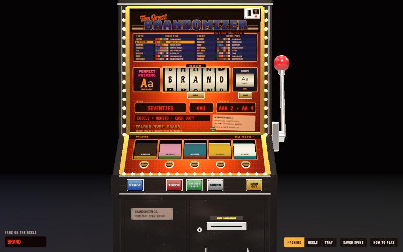
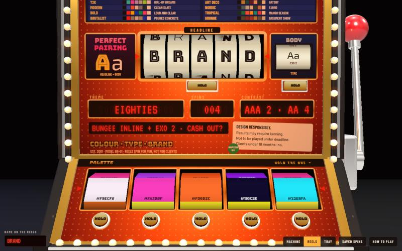
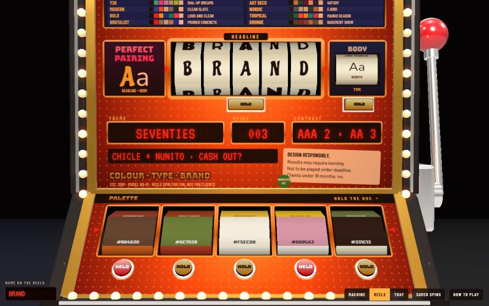
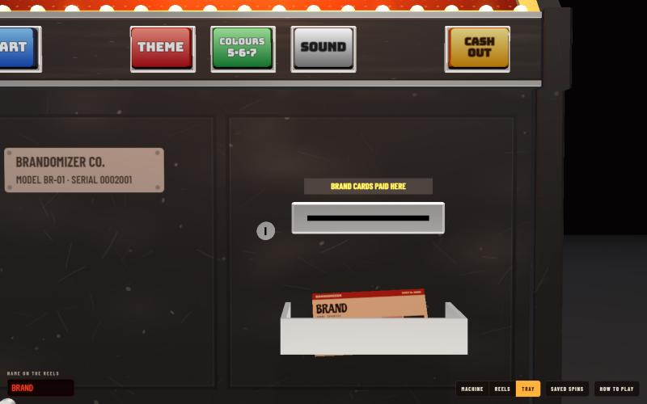
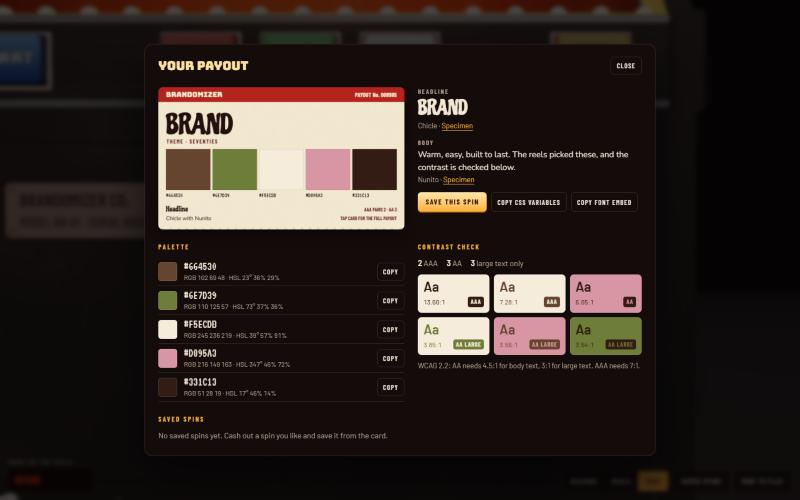

# The Great Brandomizer

A 3D vintage fruit machine that spins up brand profiles. Pull the handle and the reels land on a theme-based colour palette and a Google Fonts headline and body pairing, all checked for WCAG contrast. Hold the reels you like, spin again, and cash out a printed brand card.

### [▶ Play it in your browser](https://harrisongreener.github.io/TheGreatBrandomizer/)

Built with [three.js](https://threejs.org/) as a single HTML page. There's no build step: play it at the link above, or download `index.html` and open it in a browser.

## How it works

**Pick a theme.** Tap any row on the theme chart at the top of the machine, or press THEME to cycle. Each of the 16 themes sets its own colour rules and font list: Sixties, Seventies, Eighties, Nineties, Y2K, Modern, Bold, Brutalist, Luxury, Organic, Tech, Editorial, Art Deco, Nordic, Tropical and Grunge.

**Pull the handle.** Click the handle, press START, drop an idea in the coin slot, or press Space. The colour reels and font reels spin as real drums and land one by one. Your brand name is spelled out across the headline reels in the font that lands.

**Hold what you like.** Every reel has a HOLD button. Held reels turn red and stay put on the next spin, so you can keep two colours you love and re-roll the rest, or keep the palette and re-roll only the type. COLOURS switches between 5, 6 and 7 colour reels.

**Cash out.** CASH OUT prints a brand card into the tray. Click it for the full payout: hex, RGB and HSL values, the font pairing with specimen links, a contrast check of every colour pair, and buttons to copy the palette as CSS variables or copy the Google Fonts embed. Spins you save are kept in your browser.

## Details

- Every palette includes at least one dark and one light colour, so there's always an accessible text pair.
- A jackpot comes up about 1 in 40 spins (with no reels held). It lands on the theme's hand-picked house pick, with flashing bulbs and a bell.
- The camera opens at an angle, then settles on the machine. Drag to look around, scroll or pinch to zoom, and right-drag to pan. The Machine, Reels and Tray buttons jump to set views.
- All sounds are synthesised in the browser, and there's a SOUND button to mute them.
- Keyboard: Space spins, 1 to 7 hold colour reels, T changes theme, C cashes out, V changes view.

`prototype-1.html` is the first 2D version of the idea.

## Credits

Design and concept by Harrison Greener.
