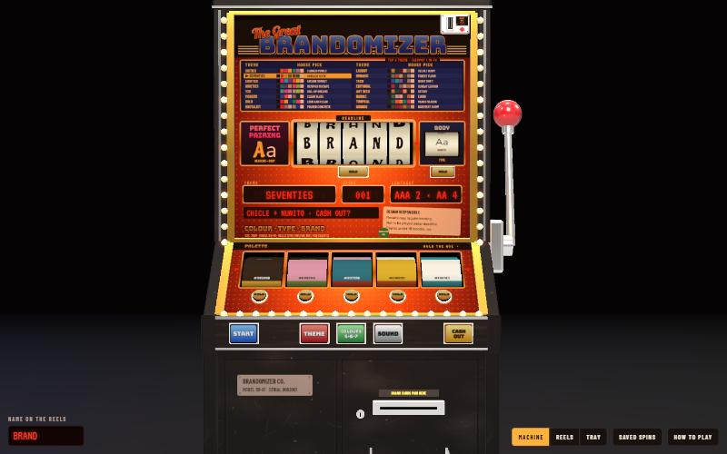
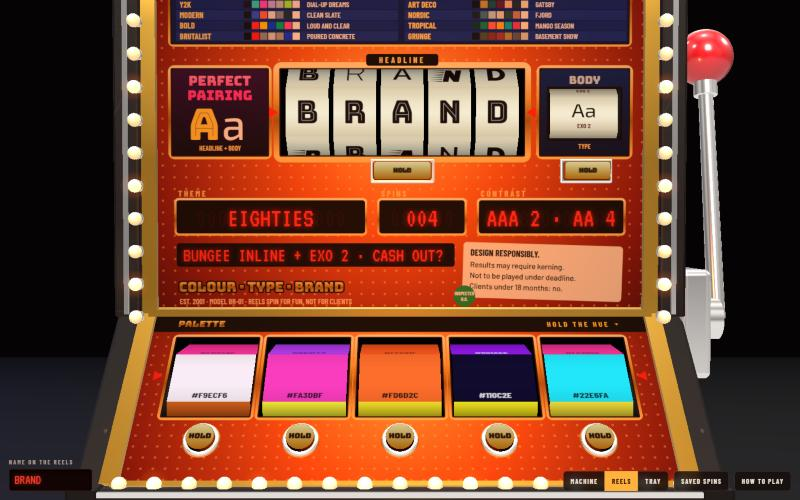
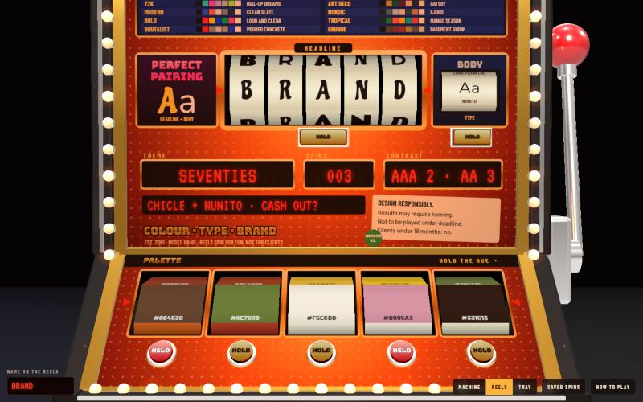
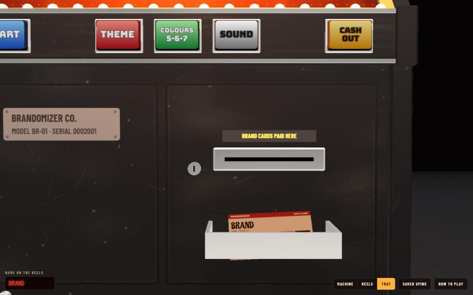
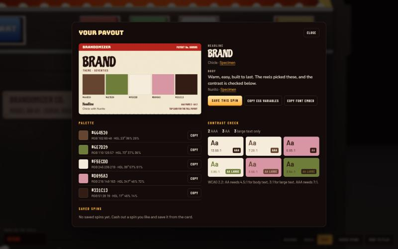

# The Great Brandomizer

A 3D vintage fruit machine that spins up brand profiles. Pick one of 35 design themes, pull the handle, and the reels land on a colour palette and a Google Fonts headline and body pairing that suit the style, all checked for WCAG contrast. Hold the reels you like, spin again, and cash out a printed brand card.

### [▶ Play it in your browser](https://harrisongreener.github.io/TheGreatBrandomizer/)

[](https://harrisongreener.github.io/TheGreatBrandomizer/)

Built with [three.js](https://threejs.org/). The machine is a single HTML page with no build step for players.

## How it works

**Pick a theme.** Open the Themes menu, tap a row on the theme chart at the top of the machine, or press THEME to cycle. There are 35 themes in four groups, each with its own colour rules and font list:

- **Eras:** Victorian, Mid-Century, Space Age, Sixties, Seventies, Eighties, Nineties, Y2K
- **Movements:** Art Nouveau, Art Deco, Bauhaus, Constructivism, De Stijl, Swiss Style, Pop Art, Psychedelic, Brutalist, Punk Zine
- **Styles:** Modern, Minimal, Bold, Luxury, Editorial, Tech, Nordic, Japandi, Organic, Tropical, Kawaii
- **Scenes:** Grunge, Vaporwave, Cyberpunk, Risograph, Gothic, Western

**Pull the handle.** Click the handle, press START, drop an idea in the coin slot, or press Space. The colour reels and font reels spin as real drums and land one by one. Your brand name is spelled out across the headline reels in the font that lands.



**Hold what you like.** Every reel has a HOLD button. Held reels turn red and stay put on the next spin. COLOURS switches between 5, 6 and 7 colour reels.



**Cash out.** CASH OUT prints a brand card into the tray. Click it for the full payout: hex, RGB and HSL values, the font pairing with specimen links, a contrast check of every colour pair, buttons to copy the palette as CSS variables or the Google Fonts embed, and Download PNG or JPEG to save the card.





## Details

- Every palette includes at least one dark and one light colour, so there's always an accessible text pair.
- A jackpot comes up about 1 in 40 spins (with no reels held). It lands on the theme's hand-picked house pick, with flashing bulbs and a bell.
- Link straight to a theme with `#theme-<id>`, for example `#theme-bauhaus`.
- Drag to look around, scroll or pinch to zoom, and right-drag to pan. The Machine, Reels and Tray buttons jump to set views.
- Keyboard: Space spins, 1 to 7 hold colour reels, T changes theme, M opens the theme menu, C cashes out, V changes view.

## The website

Alongside the machine, the site has a page for every theme (palette, HEX codes, font options, contrast check and tips), a themes index, three guides, an about page with FAQs and a privacy page. Every page has its own title, description, social image and structured data, and there's a sitemap.

The pages are generated. To change anything, edit the sources and rebuild:

- `src/app.html` is the machine itself. Theme data lives in the `THEMES` and `CATS` arrays at the top of its script.
- `src/theme-guides.json` holds the written copy for each theme page.
- `src/pages/` holds the guides and the about page.
- `site.css` styles every page except the machine.

```
python3 tools/build_site.py
```

The build needs Node.js and Python 3. Settings at the top of `tools/build_site.py` control the site address (`SITE_URL`) and Google AdSense (`ADSENSE_CLIENT`, `ADSENSE_SLOT`). Adverts only ever appear on the content pages, never on the machine.

`prototype-1.html` is the first 2D version of the idea.

## Credits

Design and concept by Harrison Greener. Fonts from Google Fonts.
